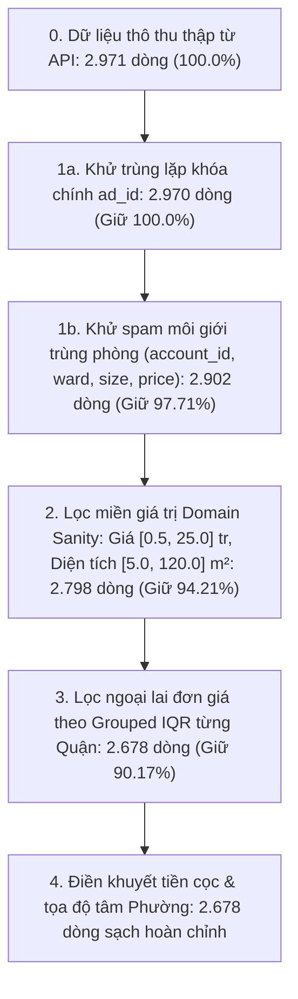

# 📋 HỒ SƠ METADATA VÀ TỪ ĐIỂN DỮ LIỆU ĐỒ ÁN (DATASET METADATA & CODEBOOK)
> **ĐẠI HỌC QUỐC GIA TP. HỒ CHÍ MINH – TRƯỜNG ĐẠI HỌC CÔNG NGHỆ THÔNG TIN (UIT)**  
> **Môn học:** IE313 – Phân tích và Trực quan hóa Dữ liệu (Data Analysis & Visualization)  
> **Tên đề tài:** Phân tích Không gian - Kinh tế thị trường phòng trọ TP.HCM & Bình Dương: Mô hình định giá hợp lý (Fair-Value Pricing) và Hệ thống phát hiện tin đăng bất thường (Scam & Good Deal Radar) trên nền tảng Chợ Tốt.  
> **Sinh viên thực hiện:** Trương Huy Hoàng (MSSV: 24520574) – Khóa 2024.  

---

## 1. THÔNG TIN TỔNG QUAN VỀ BỘ DỮ LIỆU (DATASET PROVENANCE)

| Thuộc tính (Attribute) | Giá trị đặc tả (Specification) |
| :--- | :--- |
| **Tên bộ dữ liệu** | `Southern Vietnam Rental Market Dataset (HCM & Binh Duong)` |
| **Nền tảng thu thập** | Chợ Tốt Nhà / Nhà Tốt (`nhatot.com`) – Chuyên mục Cho thuê Phòng trọ (`cg=1050`). |
| **Phương pháp thu thập** | Cào dữ liệu phân tầng tự động (**Stratified REST API Ingestion**) qua API Gateway: `https://gateway.chotot.com/v1/public/ad-listing`. |
| **Phạm vi không gian** | **30 đơn vị hành chính** (22 Quận/Huyện/TP thuộc TP.HCM + 8 Thành phố/Huyện thuộc Bình Dương). |
| **Phạm vi thời gian** | Tin đăng hoạt động từ **11/2024 đến 11/2026** (Tập trung chính vào Quý 4/2026 - dữ liệu chéo cập nhật mới nhất). |
| **Quy mô mẫu thô (Raw Data)** | **2.971 bản ghi** $\times$ **104 trường thông tin gốc** từ API (Lưu trữ tại `data/raw/chotot_raw_hcm_bd.csv` và `.xlsx`). |
| **Quy mô mẫu sạch (Cleaned Data)**| **2.678 bản ghi** $\times$ **26 trường chuẩn hóa** (Lưu trữ tại `data/processed/rental_scored_deals.csv`). |
| **Tỷ lệ giữ lại sau làm sạch** | **$90.17\%$** (Loại $9.83\%$ bao gồm spam môi giới, nhập lỗi đơn vị và ngoại lai IQR theo từng Quận). |
| **Chuẩn mã hóa ký tự** | `UTF-8 with BOM (utf-8-sig)` – Đảm bảo hiển thị tiếng Việt hoàn hảo trên Microsoft Excel, Power BI và R/Python. |

---

## 2. HƯỚNG DẪN KIỂM CHỨNG DÀNH CHO GIẢNG VIÊN (VERIFICATION GUIDE)

Thầy/Cô có thể dễ dàng kiểm chứng tính trung thực và khách quan của bộ dữ liệu bằng 2 cách:

1. **Kiểm chứng trực quan trên Web (Ground-Truth URL Check):**
   * Trong cả 2 file nộp [`chotot_raw_hcm_bd.csv`](file:///D:/UIT/FOUNDATIONAL%20SUBJECTS/IE313-Phân%20tích%20và%20trực%20quan%20dữ%20liệu/ĐỒ%20ÁN/ie313-rental-market-analytics/data/raw/chotot_raw_hcm_bd.csv) và [`chotot_raw_hcm_bd.xlsx`](file:///D:/UIT/FOUNDATIONAL%20SUBJECTS/IE313-Phân%20tích%20và%20trực%20quan%20dữ%20liệu/ĐỒ%20ÁN/ie313-rental-market-analytics/data/raw/chotot_raw_hcm_bd.xlsx), cột thứ 3 mang tên **`ad_url`** chứa đường dẫn trực tiếp:
     $$\text{ad\_url} = \text{https://www.nhatot.com/} + \text{list\_id} + \text{.htm}$$
   * Thầy/Cô có thể nhấp chuột vào bất kỳ dòng nào trong bảng Excel để mở trực tiếp tin đăng thực tế trên Chợ Tốt để đối chiếu hình ảnh, số điện thoại, giá tiền và mô tả gốc.
2. **Kiểm tra Log và Metadata cào:**
   * File [`data/raw/crawl_metadata.json`](file:///D:/UIT/FOUNDATIONAL%20SUBJECTS/IE313-Phân%20tích%20và%20trực%20quan%20dữ%20liệu/ĐỒ%20ÁN/ie313-rental-market-analytics/data/raw/crawl_metadata.json) lưu dấu thời gian từng request, tổng số 76 HTTP requests gửi đi và thống kê chi tiết số mẫu thu được ở từng Quận/Huyện.

---

## 3. QUY TRÌNH TIỀN XỬ LÝ & BÁO CÁO PHỄU LỌC (DATA CLEANING FUNNEL)

Dữ liệu được xử lý qua pipeline 5 tầng theo chuẩn khoa học dữ liệu nhằm bảo đảm dữ liệu đưa vào mô hình hóa không bị sai lệch:



* **Bảng thống kê suy giảm dữ liệu (Data Drop Funnel):**
  * `0_RawInput`: **2.971 bản ghi** (100.0%).
  * `1a_DedupAdId`: **2.970 bản ghi** (Loại 1 dòng trùng mã `ad_id`).
  * `1b_DedupBrokerSpam`: **2.902 bản ghi** (Loại **68 bản ghi** do môi giới dùng 1 tài khoản đăng đi đăng lại cùng 1 căn phòng với nhiều tiêu đề khác nhau).
  * `2_DomainSanity`: **2.798 bản ghi** (Loại **104 bản ghi** nhập nhầm đơn vị, ví dụ giá 3.500đ thay vì 3.500.000đ, hoặc đăng bán nhà tiền tỷ trong mục phòng trọ).
  * `3_GroupedIQROutliers`: **2.678 bản ghi** (Loại **120 điểm dị biệt thống kê** nằm ngoài ngưỡng $[Q_1 - 1.5\text{IQR}, Q_3 + 1.5\text{IQR}]$ của chính quận đó).
  * `4_MissingImputed`: **2.678 bản ghi** đạt độ sạch 100%, không còn giá trị `NaN` ở các trường phân tích trọng yếu.

---

## 4. TỪ ĐIỂN DỮ LIỆU CHI TIẾT (26 CỘT CHUẨN TRONG FILE NỘP)

File dữ liệu phân tích chính: [`data/processed/rental_scored_deals.csv`](file:///D:/UIT/FOUNDATIONAL%20SUBJECTS/IE313-Phân%20tích%20và%20trực%20quan%20dữ%20liệu/ĐỒ%20ÁN/ie313-rental-market-analytics/data/processed/rental_scored_deals.csv) gồm đúng **26 cột**, chia thành 5 phân nhóm nghiệp vụ:

### Phân nhóm I: Định danh & Nguồn gốc (3 cột)
| STT | Tên cột | Kiểu dữ liệu | Mô tả chi tiết & Vai trò phân tích |
| :---: | :--- | :---: | :--- |
| **1** | `ad_id` | `int64` | Khóa chính (Primary Key) duy nhất của tin đăng trên Chợ Tốt. |
| **2** | `list_id` | `int64` | Mã bài viết dùng để ghép URL kiểm chứng thực tế: `https://www.nhatot.com/{list_id}.htm`. |
| **3** | `account_id` | `int64` | Mã định danh người đăng (dùng để tính tần suất đăng bài và phân loại môi giới). |

### Phân nhóm II: Thời gian & Không gian Địa lý (8 cột)
| STT | Tên cột | Kiểu dữ liệu | Mô tả chi tiết & Vai trò phân tích |
| :---: | :--- | :---: | :--- |
| **4** | `list_time` | `datetime64` | Thời gian bài đăng được cập nhật / làm mới gần nhất trên sàn (`YYYY-MM-DD HH:MM:SS`). |
| **5** | `region_name` | `category` | Tỉnh / Thành phố: `Tp Hồ Chí Minh` (85.2%) hoặc `Bình Dương` (14.8%). |
| **6** | `area_name` | `category` | Quận / Huyện / Thành phố trực thuộc (30 đơn vị hành chính). Biến phân nhóm chính cho bài toán Spatial EDA. |
| **7** | `ward_name` | `category` | Phường / Xã / Thị trấn (dùng làm mốc nội suy tọa độ tâm). |
| **8** | `street_name` | `string` | Tên đường / trục đường giao thông nơi phòng trọ tọa lạc. |
| **9** | `longitude` | `float64` | Kinh độ địa lý (WGS84). Đã kiểm tra nằm trong miền hợp lệ $[106.2, 107.2]$. |
| **10** | `latitude` | `float64` | Vĩ độ địa lý (WGS84). Đã kiểm tra nằm trong miền hợp lệ $[10.3, 11.6]$. |
| **20** | `dist_to_q1_km` | `float64` | Khoảng cách đường chim bay Haversine (km) từ phòng trọ tới **Chợ Bến Thành, Quận 1** (`10.7725, 106.6980`). |
| **21** | `dist_to_vnuhcm_km` | `float64` | Khoảng cách đường chim bay Haversine (km) tới **Khu Đô thị ĐHQG-HCM** (`10.8756, 106.8007`). |

### Phân nhóm III: Đặc trưng Kinh tế & Thuộc tính Phòng (5 cột)
| STT | Tên cột | Kiểu dữ liệu | Mô tả chi tiết & Vai trò phân tích |
| :---: | :--- | :---: | :--- |
| **11** | `size_m2` | `float64` | Diện tích sử dụng ($m^2$), miền giá trị $[10.0, 100.0] m^2$. |
| **12** | `price_million` | `float64` | **Biến mục tiêu ($Y$):** Giá thuê phòng trọ (Triệu VNĐ/tháng), lọc miền $[0.6, 13.5]$ triệu. |
| **13** | `price_per_m2_k` | `float64` | Đơn giá thuê trên mỗi mét vuông (Nghìn VNĐ/$m^2$/tháng) = `(price_million * 1000) / size_m2`. |
| **14** | `deposit_million` | `float64` | Tiền cọc giữ chỗ (Triệu VNĐ). Được điền khuyết bằng trung vị tỷ lệ cọc/giá của từng Quận. |
| **15** | `furnishing_status` | `category` | Tình trạng nội thất: `Đầy đủ` (34.2%), `Cơ bản` (28.4%), `Nhà trống` (22.1%), `Không rõ` (15.3%). |

### Phân nhóm IV: Tiện ích Trích xuất từ Văn bản qua NLP Regex (4 cột)
| STT | Tên cột | Kiểu dữ liệu | Biểu thức Regex trích xuất | Ý nghĩa thực tế |
| :---: | :--- | :---: | :--- | :--- |
| **16** | `has_mezzanine` | `int8 (0/1)` | `(gác\s*(lửng\|cao\|đúc\|xép\|gỗ)?\|có gác\|lửng\|tầng lửng)` | Có gác lửng (tăng không gian sinh hoạt). Chiếm **23.1%** tổng mẫu. |
| **17** | `has_ac` | `int8 (0/1)` | `(máy lạnh\|điều h[oò]a\|air\s*con\|ac\b)` | Có máy lạnh/điều hòa sẵn. Chiếm **39.3%** tổng mẫu. |
| **18** | `is_free_curfew` | `int8 (0/1)` | `(giờ\s*(giấc)?\s*tự\s*do\|không chung chủ\|khoá vân tay)` | Giờ giấc tự do, khóa vân tay, không chung chủ. Chiếm **54.9%** tổng mẫu. |
| **19** | `has_balcony_window` | `int8 (0/1)` | `(ban công\|cửa sổ\|thoáng mát\|view\|ánh sáng\|logia)` | Có ban công hoặc cửa sổ thoáng đón gió. Chiếm **49.6%** tổng mẫu. |

### Phân nhóm V: Hành vi, Phân khúc & Quyết định Case Study từ Machine Learning (6 cột)
| STT | Tên cột | Kiểu dữ liệu | Nguồn gốc / Thuật toán | Ý nghĩa & Tiêu chí phân loại |
| :---: | :--- | :---: | :--- | :--- |
| **22** | `seller_type` | `category` | Behavioral Heuristics | Phân loại người đăng: `Môi giới công khai` (1.831 tin), `Chính chủ` (840 tin), `Môi giới trá hình` (7 tin). |
| **23** | `market_cluster` | `category` | K-Means ($k=3$) | Phân khúc thị trường: `Tier 1: Sinh viên/Bình dân` (985 tin), `Tier 2: Tiện nghi tầm trung` (604 tin), `Tier 3: Studio/CHDV` (1.089 tin). |
| **24** | `predicted_price` | `float64` | LightGBM / Random Forest | Giá thuê hợp lý ($\hat{y}$, Triệu VNĐ) do mô hình AI ước lượng dựa trên kích thước, vị trí và tiện ích. |
| **25** | `valuation_gap_pct` | `float64` | Residual Analysis | Độ lệch giá (%) = `((price_million - predicted_price) / predicted_price) * 100`. |
| **26** | `deal_status` | `category` | Decision Logic + Anomaly | **Nhãn giải quyết Case Study:**<br>• 🟢 `GOOD_DEAL` (37 tin): Rẻ hơn $\ge 15\%$ và do Chính chủ đăng.<br>• 🔴 `SCAM_RISK` (24 tin): Rẻ bất thường $\ge 25\%$ nhưng do Môi giới trá hình hoặc dị biệt Isolation Forest.<br>• 🟡 `OVERPRICED` (45 tin): Đắt hơn giá trị thực $\ge 20\%$.<br>• 🔵 `FAIR_PRICE` (2.572 tin): Nằm trong khoảng cân bằng cung cầu tự nhiên. |

---

## 5. BẢNG THỐNG KÊ MÔ TẢ ĐỊNH LƯỢNG (5-NUMBER DESCRIPTIVE SUMMARY)

Thống kê mô tả trên toàn bộ **2.678 mẫu sạch** đưa vào mô hình hóa:

| Biến số định lượng (Variable) | Đơn vị tính | Cỡ mẫu ($N$) | Trung bình (Mean) | Độ lệch chuẩn (Std) | Giá trị nhỏ nhất (Min) | Tứ phân vị $Q_1$ (25%) | Trung vị (Median - 50%) | Tứ phân vị $Q_3$ (75%) | Giá trị lớn nhất (Max) |
| :--- | :---: | :---: | :---: | :---: | :---: | :---: | :---: | :---: | :---: |
| **`price_million` (Giá thuê)** | Triệu VNĐ | 2.678 | **3.73** | 1.58 | 0.60 | 2.60 | **3.60** | 4.60 | 13.50 |
| **`size_m2` (Diện tích)** | $m^2$ | 2.678 | **26.34** | 9.82 | 10.00 | 20.00 | **25.00** | 30.00 | 100.00 |
| **`price_per_m2_k` (Đơn giá)** | k VNĐ/$m^2$ | 2.678 | **147.62** | 52.35 | 14.62 | 111.15 | **145.00** | 180.00 | 343.75 |
| **`dist_to_q1_km` (Cự ly Q.1)** | km | 2.678 | **7.35** | 4.99 | 0.21 | 3.70 | **6.41** | 9.50 | 44.70 |
| **`dist_to_vnuhcm_km` (Cự ly ĐHQG)**| km | 2.678 | **17.94** | 5.36 | 0.97 | 15.29 | **18.45** | 21.27 | 36.74 |

> 📌 **Nhận xét phục vụ báo cáo:**
> 1. Phân phối giá phòng trọ có trung vị là **3.60 triệu/tháng** ($50\%$ phòng trọ nằm trong khoảng $2.60 - 4.60$ triệu), phù hợp với khả năng chi trả của sinh viên và người đi làm.
> 2. Đơn giá thuê trung vị là **145.000 VNĐ/$m^2$**, dao động từ $111.000$ (vùng ven/ngoại thành) đến $180.000$ VNĐ/$m^2$ (nội thành và căn hộ dịch vụ).
> 3. Khoảng cách tới Quận 1 có độ tương quan nghịch rất mạnh với giá phòng ($\rho = -0.464, p < 10^{-140}$), minh chứng cho quy luật suy giảm giá thuê theo cự ly không gian (Spatial Distance Decay).

---

## 6. CẤU TRÚC FILE TRONG BỘ HỒ SƠ DỮ LIỆU NỘP BÀI

```text
ie313-rental-market-analytics/
├── data/
│   ├── DATASET_METADATA.md                # Bản mô tả Metadata và Codebook này
│   ├── raw/
│   │   ├── chotot_raw_hcm_bd.xlsx         # Bảng tính Excel dữ liệu thô (2.971 dòng - Thầy mở trực tiếp)
│   │   ├── chotot_raw_hcm_bd.csv          # File CSV dữ liệu thô (kèm cột ad_url để click xem web)
│   │   ├── chotot_raw_hcm_bd.jsonl        # File JSON Lines minh chứng kỹ thuật gốc
│   │   └── crawl_metadata.json            # Log thời gian, số request và phân bổ Quận
│   ├── interim/
│   │   └── deduplicated_data.parquet      # File Parquet trung gian đã khử trùng lặp sơ bộ
│   └── processed/
│       ├── rental_cleaned_full.csv        # Dữ liệu sạch đã gán đặc trưng (2.678 dòng)
│       ├── rental_scored_deals.csv        # Dữ liệu sạch 26 cột ĐÃ CHẤM ĐIỂM AI & GẮN NHÃN CASE STUDY
│       └── data_audit_report.json         # Báo cáo phễu lọc số liệu Before/After
```
