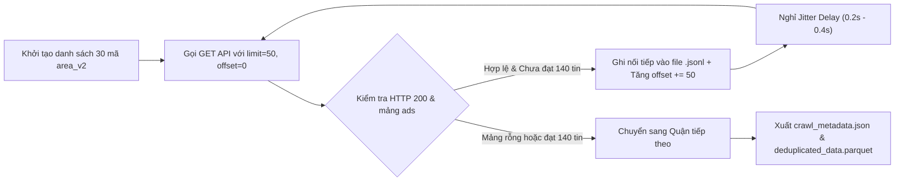

# 📡 KẾ HOẠCH THU THẬP DỮ LIỆU CHI TIẾT (DATA CRAWLING PLAN)
> **Đồ án môn học:** IE313 – Phân tích và Trực quan hóa Dữ liệu  
> **Đề tài:** Phân tích không gian - kinh tế thị trường phòng trọ TP.HCM & Bình Dương: Mô hình định giá hợp lý và Hệ thống phát hiện tin đăng bất thường trên nền tảng Chợ Tốt  
> **Mục tiêu quy mô mẫu:** **2.500 – 3.000 bản ghi** đại diện cho 30 Quận/Huyện tại TP.HCM và Bình Dương.

---

## 1. XÁC ĐỊNH NGUỒN DỮ LIỆU & CẤU TRÚC URL / API ENDPOINT

### 1.1. Nguồn dữ liệu mục tiêu
* **Nền tảng:** Chợ Tốt Nhà / Nhà Tốt (`nhatot.com`) – Nền tảng đăng tin cho thuê phòng trọ có lưu lượng người dùng lớn nhất miền Nam.
* **URL giao diện Web đối chiếu:**
  * Khu vực TP. Hồ Chí Minh: `https://www.nhatot.com/thue-phong-tro-tp-ho-chi-minh`
  * Khu vực Bình Dương: `https://www.nhatot.com/thue-phong-tro-binh-duong`
  * URL chi tiết từng bài đăng (dùng để đối chiếu/kiểm chứng trên Dashboard): `https://www.nhatot.com/{list_id}.htm`

### 1.2. Cấu trúc REST API Endpoint chính thức
Thay vì bóc tách HTML (HTML DOM Scraping) dễ bị lỗi khi giao diện thay đổi và thiếu tọa độ GPS ẩn, dự án gọi trực tiếp vào **Public API Gateway** của Chợ Tốt:

* **Base Endpoint:**
  ```http
  GET https://gateway.chotot.com/v1/public/ad-listing
  ```
* **URL đầy đủ kèm tham số truy vấn (Query String):**
  ```text
  https://gateway.chotot.com/v1/public/ad-listing?cg=1050&region_v2={region_id}&area_v2={area_id}&limit=50&o={offset}&st=u,h
  ```

### 1.3. Giải thích các Tham số Truy vấn (Query Parameters)

| Tham số | Giá trị thiết lập | Ý nghĩa kỹ thuật |
| :--- | :---: | :--- |
| `cg` | `1050` | Mã danh mục (**Category Code**) cố định của **"Phòng trọ, nhà trọ"**. |
| `region_v2` | `13000` hoặc `2011` | Mã Tỉnh/Thành phố: `13000` (TP. Hồ Chí Minh), `2011` (Bình Dương). |
| `area_v2` | `13096` $\rightarrow$ `201109` | Mã Quận/Huyện/Thành phố trực thuộc (30 đơn vị hành chính). |
| `limit` | `50` | Số lượng tin đăng trả về tối đa trong 1 lần gọi API (tối đa 50 tin/request). |
| `o` | `0, 50, 100...` | Chỉ số dịch chuyển phân trang (**Offset**): trang 1 (`o=0`), trang 2 (`o=50`), trang 3 (`o=100`). |
| `st` | `u,h` | Trạng thái tin đăng (**Status**): Lấy các tin đang hiển thị hợp lệ để cho thuê. |

### 1.4. Danh mục Mã Vùng 30 Quận/Huyện (`area_v2`)

* **TP. Hồ Chí Minh (`region_v2 = 13000` – 22 Quận/Huyện/TP):**
  * Nội thành trung tâm: Quận 1 (`13096`), Quận 3 (`13098`), Quận 4 (`13099`), Quận 5 (`13100`), Quận 6 (`13101`), Quận 10 (`13105`), Quận 11 (`13106`), Phú Nhuận (`13111`), Bình Thạnh (`13109`).
  * Nội thành mở rộng & Đông sinh viên: TP. Thủ Đức (`13119`), Quận 7 (`13102`), Quận 8 (`13103`), Quận 12 (`13107`), Gò Vấp (`13110`), Tân Bình (`13112`), Tân Phú (`13113`), Bình Tân (`13108`).
  * Ngoại thành: Bình Chánh (`13115`), Nhà Bè (`13118`), Hóc Môn (`13117`), Củ Chi (`13116`), Cần Giờ (`13120`).
* **Bình Dương (`region_v2 = 2011` – 8 TP/Thị xã/Huyện):**
  * Giáp ranh TP.HCM & Làng Đại học: TP. Dĩ An (`201107`), TP. Thuận An (`201108`), TP. Thủ Dầu Một (`201101`).
  * Khu công nghiệp vệ tinh: Thị xã Bến Cát (`201104`), Thị xã Tân Uyên (`201106`), Bàu Bàng (`201102`), Dầu Tiếng (`201103`), Bắc Tân Uyên (`201109`).

---

## 2. PHƯƠNG ÁN CÀO DỮ LIỆU (CRAWLING STRATEGY – MỤC TIÊU 2.500 – 3.000 MẪU)

### 2.1. Chiến lược Lấy mẫu Phân tầng có Hạn ngạch (Quota-based Stratified Sampling)
* **Vấn đề thực tế:** Nếu chỉ cào tuần tự ở cấp Thành phố (`region_v2=13000`), 2.500 tin mới nhất sẽ bị thống trị bởi 3–4 quận có nhiều môi giới đăng spam liên tục (như Gò Vấp, Tân Phú, Bình Thạnh), dẫn đến thiếu hụt mẫu ở các quận trung tâm (Quận 1, 3, 4, 5) hoặc khu vực Làng Đại học (Dĩ An, Thủ Đức) và ngoại thành.
* **Giải pháp phân tầng:**
  * Thiết lập hạn ngạch **`max_per_area = 140` tin/Quận** (tương đương tối đa 3 trang `offset = 0, 50, 100` cho mỗi Quận).
  * Với **16 Quận lớn** có trên 140 tin đăng: Thu thập đúng **140 tin/Quận** ($16 \times 140 = 2.240$ mẫu).
  * Với **14 Quận/Huyện nhỏ hơn** (như Quận 4, Củ Chi, Hóc Môn, Nhà Bè, Thủ Dầu Một, Thuận An, Bến Cát...): Thu thập **100% số tin hiện có** ($\approx 600$ mẫu).
  * **Tổng quy mô thu được:** **$\approx 2.840$ mẫu thô** (sau khi đi qua phễu lọc trùng lặp và ngoại lai sẽ thu được **$\approx 2.500 - 2.600$ mẫu sạch chất lượng cao**), đạt đúng mục tiêu 2.000 – 3.000 mẫu và đại diện toàn diện cho không gian địa lý.

### 2.2. Quy trình Kỹ thuật & Chống chặn (Anti-Blocking & Resilience)

1. **Giả lập trình duyệt (Custom Headers):** Gửi kèm `User-Agent` chuẩn Chrome Windows 10 và `Accept-Language: vi-VN`.
2. **Độ trễ ngẫu nhiên (Polite Jitter Delay):** Nghỉ ngẫu nhiên `0.20s – 0.35s` giữa các request để không gây quá tải máy chủ đích.
3. **Cơ chế Tự động Thử lại (Exponential Backoff Retry):** Nếu gặp lỗi mạng tạm thời hoặc timeout, script tự động chờ $1.5 \times \text{attempt}$ giây và thử lại tối đa 3 lần.
4. **Ghi dữ liệu tức thời (Streaming Flush):** Mỗi bản ghi JSON nhận về được bổ sung nhãn thời gian `_crawled_at` và ghi ngay xuống ổ đĩa (`jsonl_file.flush()`), đảm bảo không mất dữ liệu nếu ngắt kết nối giữa chừng.

---

## 3. ĐỊNH DẠNG LƯU TRỮ DỮ LIỆU ĐA TẦNG (STORAGE FORMATS)

Dự án tổ chức lưu trữ dữ liệu theo 3 tầng chuẩn mực để vừa giữ được bằng chứng gốc, vừa tối ưu tốc độ đọc/ghi khi phân tích:

| Tầng dữ liệu | Đường dẫn File | Định dạng | Mục đích & Ưu điểm kỹ thuật |
| :--- | :--- | :---: | :--- |
| **1. Raw Layer** | `data/raw/chotot_raw_hcm_bd.jsonl` | **JSON Lines (`.jsonl`)** | Mỗi dòng là 1 JSON object nguyên bản từ API. Không bị vỡ cột khi bài đăng chứa ký tự xuống dòng `\n`, dấu phẩy `,` hay mảng lồng nhau (`params`, `pty_characteristics`). |
| **Raw Audit** | `data/raw/crawl_metadata.json` | **JSON (`.json`)** | Lưu thời gian bắt đầu/kết thúc, tổng số HTTP requests, số lượng mẫu thu thập được ở từng Quận/Huyện. |
| **2. Interim Layer** | `data/interim/deduplicated_data.parquet` | **Apache Parquet (`.parquet`)** | Định dạng lưu trữ hướng cột (Columnar Storage) nén cao, bảo toàn kiểu dữ liệu và tăng tốc độ đọc gấp 10 lần CSV. |
| **3. Processed Layer** | `data/processed/rental_cleaned_full.csv`<br>`data/processed/rental_scored_deals.csv` | **CSV (`utf-8-sig`)** | Dữ liệu bảng phẳng gồm **26 cột chuẩn hóa**, mã hóa `utf-8-sig` (có BOM) để mở trực tiếp trên **Microsoft Excel** và **Power BI** không bị lỗi font tiếng Việt. |

---

## 4. ĐẶC TẢ CHI TIẾT CÁC CỘT DỮ LIỆU (SCHEMA & FIELD MAPPING)

Dưới đây là bảng ánh xạ từ **trường JSON gốc của API Chợ Tốt** sang **26 cột của bộ dữ liệu đích (`rental_scored_deals.csv`)**, bao gồm quy tắc chuyển đổi và làm sạch:

### Nhóm 1: Định danh, Thời gian & Hành vi Người đăng (5 cột)

| STT | Tên cột chuẩn | Trường JSON gốc | Kiểu dữ liệu | Quy tắc biến đổi & Xử lý |
| :---: | :--- | :--- | :---: | :--- |
| **1** | `ad_id` | `ad["ad_id"]` | `int64` | Khóa chính duy nhất của tin đăng. Dùng để khử trùng lặp Tầng 1a. |
| **2** | `list_id` | `ad["list_id"]` | `int64` | Mã bài viết dùng ghép URL xem tin thật: `https://www.nhatot.com/{list_id}.htm`. |
| **3** | `account_id` | `ad["account_id"]` | `int64` | Mã tài khoản người đăng. Dùng để đếm tần suất đăng bài và lọc spam trùng phòng. |
| **4** | `list_time` | `ad["list_time"]` | `datetime64` | Chuyển đổi từ Unix Timestamp (mili-giây) sang ngày giờ chuẩn `YYYY-MM-DD HH:MM:SS`. |
| **22** | `seller_type` | `ad["company_ad"]` + `account_id` | `category` | Nếu `company_ad == True` $\rightarrow$ `Môi giới công khai`; Nếu đăng $\ge 4$ tin nhưng ẩn danh cá nhân $\rightarrow$ `Môi giới trá hình`; Ngược lại (1–3 tin) $\rightarrow$ `Chính chủ`. |

### Nhóm 2: Không gian Địa lý & Khoảng cách Haversine (8 cột)

| STT | Tên cột chuẩn | Trường JSON gốc | Kiểu dữ liệu | Quy tắc biến đổi & Xử lý |
| :---: | :--- | :--- | :---: | :--- |
| **5** | `region_name` | `ad["region_name"]` | `category` | Tỉnh/Thành phố (`Tp Hồ Chí Minh`, `Bình Dương`). |
| **6** | `area_name` | `ad["area_name"]` | `category` | Quận/Huyện/Thành phố (30 đơn vị hành chính). Dùng làm khóa phân nhóm IQR. |
| **7** | `ward_name` | `ad["ward_name"]` | `category` | Phường/Xã/Thị trấn. Dùng làm khóa nội suy tâm tọa độ khi tin đăng bị khuyết GPS. |
| **8** | `street_name` | `ad["street_name"]` | `string` | Tên đường/trục đường. Nếu trống điền `"Đang cập nhật"`. |
| **9** | `longitude` | `ad["longitude"]` | `float64` | Kinh độ GPS. Kiểm tra miền hợp lệ $[106.2, 107.2]$; nếu khuyết gán bằng Median Centroid của Phường. |
| **10** | `latitude` | `ad["latitude"]` | `float64` | Vĩ độ GPS. Kiểm tra miền hợp lệ $[10.3, 11.6]$; nếu khuyết gán bằng Median Centroid của Phường. |
| **20** | `dist_to_q1_km` | *Tính từ (9), (10)* | `float64` | Khoảng cách đường chim bay Haversine (km) tới Chợ Bến Thành, Quận 1 (`10.7725, 106.6980`). |
| **21** | `dist_to_vnuhcm_km` | *Tính từ (9), (10)* | `float64` | Khoảng cách đường chim bay Haversine (km) tới Khu Đô thị ĐHQG-HCM (`10.8756, 106.8007`). |

### Nhóm 3: Kinh tế, Diện tích & Nội thất (5 cột)

| STT | Tên cột chuẩn | Trường JSON gốc | Kiểu dữ liệu | Quy tắc biến đổi & Xử lý |
| :---: | :--- | :--- | :---: | :--- |
| **11** | `size_m2` | `ad["size"]` | `float64` | Diện tích phòng ($\text{m}^2$). Lọc miền hợp lệ $[5.0, 120.0]\text{ m}^2$. |
| **12** | `price_million` | `ad["price"]` | `float64` | **Biến mục tiêu ($Y$):** `price / 1_000_000` (Triệu VNĐ/tháng). Lọc miền hợp lệ $[0.5, 25.0]$ triệu. |
| **13** | `price_per_m2_k` | *Tính từ (11), (12)* | `float64` | Đơn giá thuê trên mỗi $\text{m}^2$ (Nghìn VNĐ/$\text{m}^2$) = `(price_million * 1000) / size_m2`. Lọc ngoại lai theo Grouped IQR từng Quận. |
| **14** | `deposit_million` | `ad["deposit"]` | `float64` | Tiền cọc (`deposit / 1_000_000`). Nếu khuyết hoặc $=0$, nội suy theo trung vị tỷ lệ cọc/giá của Quận đó. |
| **15** | `furnishing_status` | `ad["furnishing_rent"]` | `category` | Ánh xạ mã số: `1` $\rightarrow$ `Đầy đủ`, `2` $\rightarrow$ `Cơ bản`, `3` $\rightarrow$ `Nhà trống`, `NaN` $\rightarrow$ `Không rõ`. |

### Nhóm 4: Đặc trưng Văn bản NLP Regex (4 cột)

Trích xuất từ chuỗi gộp tiêu đề và mô tả chi tiết: `text = lower(ad["subject"] + " " + ad["body"])`

| STT | Tên cột chuẩn | Từ khóa nhận diện (Regex Pattern) | Kiểu dữ liệu | Ý nghĩa |
| :---: | :--- | :--- | :---: | :--- |
| **16** | `has_mezzanine` | `(gác\s*(lửng\|cao\|đúc\|xép\|gỗ)?\|có gác\|lửng\|tầng lửng)` | `int8 (0/1)` | Phòng có gác lửng giúp tăng diện tích sử dụng. |
| **17** | `has_ac` | `(máy lạnh\|điều h[oò]a\|air\s*con\|ac\b)` | `int8 (0/1)` | Phòng trang bị sẵn máy lạnh / điều hòa. |
| **18** | `is_free_curfew` | `(giờ\s*(giấc)?\s*tự\s*do\|không chung chủ\|riêng biệt\|khoá vân tay)` | `int8 (0/1)` | Giờ giấc tự do, không chung chủ, khóa vân tay. |
| **19** | `has_balcony_window` | `(ban công\|cửa sổ\|thoáng mát\|view\|ánh sáng\|logia)` | `int8 (0/1)` | Có ban công, cửa sổ lớn hoặc không gian thoáng sáng. |

### Nhóm 5: Đầu ra Mô hình Học máy & Nhãn Quyết định Case Study (4 cột)

| STT | Tên cột chuẩn | Nguồn mô hình | Kiểu dữ liệu | Công thức & Quy tắc phân loại |
| :---: | :--- | :--- | :---: | :--- |
| **23** | `market_cluster` | `K-Means (k=3)` | `category` | Phân cụm tự động theo đơn giá & tiện nghi: `Tier 1: Sinh viên/Bình dân`, `Tier 2: Tiện nghi tầm trung`, `Tier 3: Studio/Căn hộ dịch vụ`. |
| **24** | `predicted_price` | `LightGBM Regressor` | `float64` | Giá thuê hợp lý ($\hat{y}$, Triệu VNĐ/tháng) do mô hình AI dự đoán dựa trên vị trí, diện tích và tiện ích. |
| **25** | `valuation_gap_pct` | *Residual Analysis* | `float64` | Độ lệch định giá (%) = `((price_million - predicted_price) / predicted_price) * 100`. Âm là rẻ hơn thị trường, dương là đắt hơn. |
| **26** | `deal_status` | `Rule + Isolation Forest` | `category` | - `SCAM_RISK`: `valuation_gap_pct <= -25%` VÀ (`Môi giới trá hình` hoặc điểm dị biệt Isolation Forest).<br>- `GOOD_DEAL`: `valuation_gap_pct <= -15%` VÀ `Chính chủ`.<br>- `OVERPRICED`: `valuation_gap_pct >= +20%`.<br>- `FAIR_PRICE`: Trong ngưỡng cân bằng $[-15\%, +20\%]$. |

---

## 5. LỆNH THỰC THI THU THẬP 2.500 – 3.000 MẪU

Để thực thi đúng kế hoạch lấy mẫu phân tầng với hạn ngạch `140 tin/Quận` (tổng thu thập ~2.840 mẫu thô), chạy lệnh sau tại thư mục gốc của dự án:

```bash
# Bước 1: Chạy Crawler phân tầng với hạn ngạch 140 mẫu/Quận
python -m src.crawler --regions 13000 2011 --max-per-area 140 --delay 0.2 --overwrite

# Bước 2: Làm sạch 5 tầng & Xuất báo cáo Data Funnel
python -m src.cleaner

# Bước 3: Trích xuất đặc trưng NLP Regex, Haversine & Phân cụm K-Means
python -m src.features

# Bước 4: Huấn luyện LightGBM, Isolation Forest & Xuất 26 cột chuẩn
python -m src.models
```

